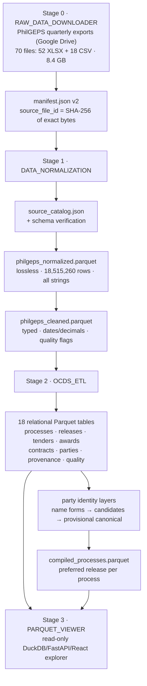

# PhilGEPS data outputs — end-to-end dataset guide

This document describes every dataset produced by the PhilGEPS pipeline, from
the original downloads to the final analytical tables and the viewer. For each
dataset it explains **what it is**, **how it was produced**, and **why it was
processed that way**.

All row counts and file sizes below were verified directly against the live
Parquet files with DuckDB on **2026-10-30**. Where a project document still
describes an earlier build (67 source files / 17,528,727 rows), this document
uses the **current verified numbers** (70 source files / 18,515,260 rows); see
[Documentation drift](#11-documentation-drift).

---

## Contents

1. [Pipeline at a glance](#1-pipeline-at-a-glance)
2. [Stage 0 — Source downloads (RAW_DATA_DOWNLOADER)](#2-stage-0--source-downloads-raw_data_downloader)
3. [Stage 1 — DATA_NORMALIZATION](#3-stage-1--data_normalization)
4. [Stage 2 — OCDS_ETL](#4-stage-2--ocds_etl)
5. [Stage 3 — PARQUET_VIEWER derived caches](#5-stage-3--parquet_viewer-derived-caches)
6. [Complete dataset inventory](#6-complete-dataset-inventory)
7. [Provenance and traceability model](#7-provenance-and-traceability-model)
8. [Why the pipeline is shaped this way](#8-why-the-pipeline-is-shaped-this-way)
9. [Known limitations and open policies](#9-known-limitations-and-open-policies)
10. [How to rebuild everything](#10-how-to-rebuild-everything)
11. [Documentation drift](#11-documentation-drift)

---

## 1. Pipeline at a glance



| Stage | Project | Primary outputs | Volume (verified) |
|---|---|---|---|
| 0 | `RAW_DATA_DOWNLOADER` | 70 source files + `manifest.json` | 8.4 GB sources |
| 1 | `DATA_NORMALIZATION` | 2 combined Parquets + QA artifacts | 2.4 GiB |
| 2 | `OCDS_ETL` | 18 relational Parquets + evidence artifacts | 14.1 GiB |
| 3 | `PARQUET_VIEWER` | Disposable search/provenance caches | ~15.7 GiB (rebuilt on demand) |

The whole chain is orchestrated by [`run_complete_etl.ps1`](run_complete_etl.ps1)
at the repository root, which runs every stage in order with resume switches.

---

## 2. Stage 0 — Source downloads (RAW_DATA_DOWNLOADER)

> The `RAW_DATA_DOWNLOADER/` folder is git-ignored and not required to exist
> for later stages to query data, but the manifest it produced is the
> provenance backbone of everything downstream. Described here from the
> manifest, catalog, and pipeline script.

### What was downloaded

PhilGEPS publishes procurement exports (bid notices and award details) as
quarterly/annual workbooks on Google Drive. `scripts/download_gdrive_sources.py`
reads a URL list (e.g. `references/source_urls_4.txt`) and downloads or resumes
each file into `dataset/files/`. Current catalog state:

- **70 local files** — 52 XLSX and 18 CSV
- **71 source URLs** (one file, `2025_(JUL-SEPT).csv`, is reachable through two
  URLs with the same SHA-256)
- Coverage spans 2000–2025; the 2000 workbook is mapped to period
  `2000-11--2000-12` from its embedded report period, not its annual-looking
  filename

### `dataset/manifest.json` (manifest v2)

**What it is.** The authoritative registry of every source byte ever
downloaded.

**How it is produced.** `scripts/rebuild_manifest.py` (run by the orchestrator
immediately after download) hashes each file and records:

- `source_file_id` — derived from the file's **SHA-256**, so the identity is
  stable across renames and moves;
- `document_id` — identifies one exact source **URL**, so several documents can
  point to the same physical file;
- original filename, normalized filename (`YYYY-MM--YYYY-MM.ext`), checksum,
  local path, and URL(s).

**Why.** Separating *byte identity* from *URL identity* means a file re-shared
under a new link does not become a "new" source, and every downstream row can
carry a compact foreign key (`source_file_id`) instead of repeating filenames
and URLs millions of times. `rebuild_manifest.py` is content-addressed, so
manifest regeneration is idempotent.

### Why the sources are hard to consume directly

The 70 files expose **four different physical layouts** (plus a
header-presence variation), which is why nothing downstream trusts filenames or
years:

| Layout | Files | Rows (current build) | Characteristic |
|---|---:|---:|---|
| `modern_43` | 40 | 8,544,543 | 43 cols, header on row 1; adds `Client Agency`, `Created By`, `Awardee Contact Person` |
| `location_46` | 18 | 8,050,724 | 46 cols with location enrichment (CSV era) |
| `legacy_40_uom` | 11 | 1,595,484 | 40 cols, header on visible Excel row 4 (2000–2010 workbooks) |
| `legacy_40_unit_of_measurement` | 1 | 324,509 | Same 40-col layout, unit field renamed (Oct–Dec 2017) |

Sixteen-plus of the CSVs are headered; at least four verified CSVs
(`2021_Oct-Dec.csv`, `2022_Apr-Jun.csv`, `2022 _Jul-Sep.csv`,
`2022 _Oct-Dec.csv`) are **headerless** and can only be mapped by column
position. Workbooks use a single `Sheet1`.

---

## 3. Stage 1 — DATA_NORMALIZATION

Project: [`DATA_NORMALIZATION/`](DATA_NORMALIZATION/README.md). Its job is to
turn 70 heterogeneous spreadsheets into **two** deliberately layered datasets —
one lossless, one typed — without ever losing the ability to point at the
original cell.

### 3.1 `artifacts/source_catalog.json`

**What it is.** A machine-readable inventory of every source file: format,
size, SHA-256, sheets, URLs, detected schema, and diagnostics.

**How.** `scripts/build_source_catalog.py` reads manifest v2 and inspects each
file's headers/layout (no data rows required; `--verify-hashes`/`--count-csv-rows`
enable a full audit).

**Why.** Schema detection must be *evidence*, not assumption: the catalog is
what lets the normalizer map a file by verified header aliases and only fall
back to column position for conclusively identified headerless exports.

### 3.2 `artifacts/schema_verification.json` and `headerless_schema_verification.json`

**What they are.** Proof that each of the four layouts (and each headerless
CSV) was identified correctly — expected headers, positions, and anomalies.

**How.** `scripts/verify_schema.py` and `scripts/verify_headerless.py` validate
every file against the catalog before any data is transformed. The normalizer
build fails if a file does not match a verified schema.

**Why.** A silent mis-map would shuffle columns across 18.5 million rows; this
gate makes layout drift impossible to miss.

### 3.3 `output/philgeps_normalized.parquet` — the lossless layer

**What it is.** Every non-blank source row from all 70 files in **one**
Parquet, schema-normalized but otherwise untouched.

| Property | Value (verified 2026-10-30) |
|---|---|
| Rows | **18,515,260** |
| Columns | **60** (55 canonical data + 5 provenance/retention) |
| Source files | 70 of 70 |
| Row groups | 778 |
| Size | 1,309,312,456 bytes (1.22 GiB) |
| Compression vs source | ~15.6% (8.39 GB → 1.31 GB) |
| Duplicate breadcrumbs | 0 |

**How.** `scripts/build_normalized_parquet.py` streams all 70 files directly
into one temporary Parquet (Zstandard) and **atomically renames** it into place
only after a successful build — no partial outputs, no per-source Parquets.
Each source layout's columns are mapped onto canonical snake_case names
(`bid_reference_no`, `notice_title`, `awardee_organization_name`, …) using
verified header aliases; headerless CSVs use conclusively verified positions.
Physical row numbers are preserved exactly as a user sees them (legacy Excel
data starts at row 5, headered CSVs at row 2, headerless CSVs at row 1).

Every row carries the breadcrumb:

- `_source_file_id` — foreign key to manifest v2
- `_source_sheet` — worksheet (null for CSV)
- `_source_row_number` — visible physical row
- `_source_schema_id` — which verified layout produced the row
- `_extra_values` — any unexpected trailing values (currently 0 rows affected)

**Why strings, why lossless.** All source values stay **nullable strings** —
no deduplication, no corrections, no type coercion. Rationale:

- PhilGEPS documents are the source of truth; the normalized layer must be a
  faithful, reversible image of them.
- Typing decisions (what is a date, what is a number, what is "null") are
  *policy*, and policy must be measurable before it is applied — so parse
  quality is measured in the cleaned layer instead.
- Duplicate exports exist on purpose (the same quarter re-published). Choosing
  a "winner" at ingestion would destroy evidence; overlaps are kept and
  resolved later with recorded rules.

Ingestion QA (recorded in `artifacts/raw_ingestion/`, per-file JSON + summary):
663,074 blank formatted XLSX rows skipped, 2,312 formula cells read from cached
values, 10 cells containing Unicode replacement characters (retained, flagged —
never "repaired"), 0 malformed-width rows. Validation lives in
`artifacts/normalized_parquet_validation.json`.

### 3.4 `output/philgeps_cleaned.parquet` — the typed analytical layer

**What it is.** The same 18,515,260 rows, same provenance, but typed and
consistently normalized for analysis. This is the file OCDS_ETL consumes.

| Property | Value (verified) |
|---|---|
| Rows | 18,515,260 (identity with normalized layer provenance verified by count + hash) |
| Columns | **66** (60 + 3 organization comparison keys + 3 cleaning-diagnostic columns) |
| Size | 1,261,524,052 bytes (1.17 GiB) |
| Rows with ≥1 cleaning flag | 806,356 |

**How.** `scripts/build_cleaned_parquet.py` applies rules that are *explicitly
configured* in `config/cleaning_rules.json` — nothing is hard-coded per source:

- **Null semantics** — empty strings and case-insensitive `NULL`/`N/A`/`NA`/
  `NONE` become true nulls; the observed item-budget sentinels `-1`/`-1.00`
  become null *and* set an `item_budget_not_provided_sentinel` flag (589,612
  rows) so the original meaning survives.
- **Typing** — 8 date fields become timestamps (`DD/MM/YYYY` for text, the
  1899-12-30 Excel serial epoch for spreadsheets); monetary fields become
  `DECIMAL(38,4)` (kills binary float tails, keeps real precision); quantity
  `DECIMAL(38,6)`; durations and line numbers `BIGINT`. Bid/award references
  and UNSPSC codes **stay strings** because they are identifiers, not numbers
  (leading zeros matter).
- **Text** — NFC Unicode normalization and trimming everywhere; repeated
  whitespace collapsed for organization names and categories. Observed
  `DisApproved` → `Disapproved`; `Undefined` stays an explicit category
  instead of being guessed into null.
- **Organization keys** — three uppercase comparison keys
  (`procuring_entity_name_key`, `client_agency_key`,
  `awardee_organization_name_key`) enable grouping *without* merging entities;
  punctuation and spelling remain significant.
- **Encoding defects** — `_replacement_character_columns` names the exact
  columns containing U+FFFD (8 rows / 10 cells). Nothing is guessed.

**Why flags instead of fixes.** `_cleaning_issues` is a per-row list of
non-destructive findings — evidence for review, not assertions that the record
is wrong. Current top flags: `item_budget_not_provided_sentinel` (589,612),
`award_before_bid_published` (179,717),
`contract_end_before_notice_to_proceed` (30,968),
`contract_amount_exceeds_approved_budget` (9,561),
`item_budget_exceeds_approved_budget` (5,200),
`invalid_contract_end_date` (11), `replacement_character` (8),
`missing_bid_reference` (1). The build then re-validates itself: zero duplicate
breadcrumbs, zero residual null literals, zero whitespace leaks, and a
count/hash match of the full provenance tuple against the normalized input
(`artifacts/cleaned_parquet_validation.json`).

### 3.5 Other Stage-1 artifacts (QA metadata, not datasets)

- `artifacts/raw_ingestion/files/*.json` — per-source QA (rows written,
  anomalies) for the normalized build
- `artifacts/delta_2023_q3.json/` — incremental re-download audit for the
  2023 Q3 file
- `artifacts/normalized_parquet_validation.json`,
  `artifacts/cleaned_parquet_validation.json` — machine-readable post-build
  checks (note: the normalized one currently reflects the *previous* 67-file
  build — see [Documentation drift](#11-documentation-drift))

---

## 4. Stage 2 — OCDS_ETL

Project: [`OCDS_ETL/`](OCDS_ETL/README.md). This stage reshapes the cleaned
observation table into an **OCDS-aligned relational model** — 18 Parquet
tables under `outputs/parquet/` — where a "release" is an immutable observed
state of a contracting process. (OCDS 1.1.5 is the target standard; formal
conformance applies to a future JSON export, not to these Parquets.)

### 4.1 Design evidence produced before any table was built

Profiling was done *first* so that identifier rules are grounded in measured
behavior of all 18.5M rows (key artifacts under `OCDS_ETL/artifacts/`):

- **`grain_profile.json/.md`** — reuse/missingness/conflict analysis for every
  candidate key. Findings that shaped the model: `bid_reference_no` is the best
  process key (10.3M distinct values), but `0` is a placeholder in ~405k rows;
  solicitation numbers are heavily reused (up to 18k bid references share one
  solicitation) so they cannot identify processes; contract numbers are reused
  across processes (max 5,210 processes per number) and sometimes across
  awards; award references are reused across processes; item line numbers
  locate items but 3.5k process/line groups change content over time.
- **`codelist_profile.json/.md`** — every observed value in the five mapped
  categorical domains, so codelist mappings are exhaustive by evidence.
- **`id_profile.test.*`, `mapping_coverage.json`** — deterministic ID/hash
  payload tests and field-mapping coverage (all 66 cleaned fields accounted
  for).
- **`config/field_mapping.json`, `config/codelist_mapping.json`,
  `config/publication.json`** — the executable mapping, validated by
  `scripts/validate_mapping_config.py` before every build.

### 4.2 Internal build state: `outputs/.build/release_index.parquet`

During the core build, `scripts/build_parquet.py` first writes an internal
index mapping every source-observation key to its deterministic process and
release IDs. It is **build state, not a published dataset** — final tables join
through it and are independently restartable; it is not part of the documented
data contract.

### 4.3 The published tables

All identifiers are strings with type prefixes: `pgcp_` (process), `pgrl_`
(release), `pgti_` (tender item), `pgaw_` (award), `pgct_` (contract), `pgpa_`
(party mention), `pgca_` (provisional canonical party). The suffix is a
lowercase SHA-256 over a versioned canonical identity payload, so IDs are
deterministic and reproducible.

#### Process spine

**`contracting_processes.parquet` — 11,245,628 rows (1.15 GiB).**
One row per inferred contracting process; PK `process_id`. The process key is
the accepted `bid_reference_no` when valid; for the ~405k placeholder/missing
rows, a composite of procuring entity + solicitation + title + publication
date, and finally the immutable source breadcrumb — each fallback explicitly
recorded in `source_identifier_basis` so weak identities are never mistaken
for strong ones. `ocid` remains null until an official OCID prefix is
registered.

**`releases.parquet` — 11,246,324 rows (1.21 GiB).**
One row per **distinct observed state** of a process; PK `release_id`
(content-addressed). Why content-addressed: PhilGEPS re-publishes identical
rows across quarterly exports — identical states share one release with
multiple source links, while genuinely different states for the same process
become separate immutable releases. Nothing about a filename influences
identity. Each release carries `release_date` with an explicit
`release_date_basis` and confidence (award publication → bid publication →
award decision → export-observation fallback), OCDS-style `tags`, and a
`content_hash` over the canonical mapped state.

**`compiled_processes.parquet` — 11,245,628 rows (0.77 GiB).**
A compact **join index** selecting one preferred release per process under
versioned rule `process-compilation-v1` (latest release date → lifecycle
completeness → source coverage → deterministic tie-break). Current selection:
11,244,932 `only_release`, 693 `latest_release_date`, 3
`same_date_source_coverage`. It never overwrites history — it exists so
analysts can join "the current state" without re-implementing preference
logic, while child data stays in the lossless tables.

**`process_release_history.parquet` — 1,392 rows (136 KB).**
Chronological and preference ranks, content hashes, and change-from-previous
flags for the 696 multi-release processes. Single-release processes are omitted
because their preferred release is trivially the only one.

#### Tender objects

**`tenders.parquet` — 11,246,323 rows (1.27 GiB).** 0-or-1 tender per release
(PK/FK `release_id`): title, status, notice type, procurement method (source
label + OCDS broad method), category, funding, value, publication date, tender
period end, pre-bid milestone, duration, plus local fields that have no safe
OCDS home yet.

**`tender_items.parquet` — 9,439,960 rows (0.77 GiB).** One item per release;
PK `(release_id, item_id)`. `item_id` is the line-item number when unique
within the process, otherwise a deterministic hash — because the profile showed
line numbers are *positions*, not identities (3.5k groups change content).
Item budgets stay a local analytical field until total-vs-unit semantics are
confirmed.

#### Award objects

**`awards.parquet` — 4,927,567 rows (0.41 GiB).** One award per release; PK
`(release_id, award_id)`. Award IDs are **process-scoped** (references are
reused across processes — measured, then scoped accordingly).

**`award_items.parquet` — 4,854,908 rows (0.42 GiB).** Award↔item links created
**only** when the flat source row defensibly ties them — never by assuming an
award covers every item.

**`award_suppliers.parquet` — 6,919,984 rows (0.73 GiB).** One observed
supplier-to-award *assertion*; PK `award_supplier_assertion_id`. Rows with a
missing or ambiguous award or party link are **retained** with
`award_link_status`/`party_link_status` = `matched`/`missing`/`ambiguous`
rather than dropped — only fully matched assertions realize OCDS
`awards[].suppliers[]`; the rest remain evidence and publication-blocking
findings. Joint ventures (74,541 unparsed values) are deliberately not split
until their semantics are verified.

#### Contracts

**`contracts.parquet` — 3,509,890 rows (0.38 GiB).** One contract per release;
PK `(release_id, contract_id)`. Contract identity is **award-scoped** because
contract numbers are missing from over half the evidence rows and heavily
reused. A contract whose award cannot be matched is kept with
`award_link_status` and a quality flag — the analytical table refuses to
invent a foreign key just to look tidy; only `matched` contracts may enter a
future standards-valid OCDS JSON package.

#### Parties and identity resolution (four staged layers)

The party problem in PhilGEPS data is that the same legal entity appears under
many spellings (`EMCOR INC`, `EMCOR, INC.`, `EMCOR, INCORPORATED`). The
pipeline stages the evidence instead of guessing merges:

**`parties.parquet` — 15,035,037 rows (1.13 GiB).** One party **mention** per
release; PK `(release_id, party_id)`. Names, organization type/size, addresses
(retained raw for future PSGC normalization), contacts. A mention ID is
release-scoped by design — it is *not* cross-process entity resolution.

**`party_roles.parquet` — 15,213,659 rows (0.86 GiB).** One role per party per
release (`procuringEntity`, `buyer`, `supplier`); PK
`(release_id, party_id, role)`. Tenderer/consortium roles wait on verified
source fields.

**`party_name_forms.parquet` — 180,147 rows (14.4 MiB).** One row per
**distinct observed name** (not per mention); PK `name_form_id` (deterministic
from the exact name). Built by `scripts/build_party_name_forms.py` under
versioned rule `party-name-v1`: preserves the source spelling, then derives
three keys — conservative, punctuation-folded, and legal-suffix-canonicalized
(`Incorporated` → `inc`, etc.) — each a *matching aid*, never a merge
authority. Counts quantify the evidence behind every key.

**`party_resolution_candidates.parquet` — 421,317 rows (48.7 MiB).** The
review queue: mentions belonging to multi-spelling groups, annotated with
location/organization context overlap and an `evidence_status`
(`corroborated_candidate`, `partial_context`, `divergent_location_context`,
`name_only`). `resolution_status` stays `unresolved` and
`automatic_merge_allowed` is false — equal keys alone never merge entities.

**`canonical_parties.parquet` — 341 rows (~40 KB)** and
**`party_aliases.parquet` — 9,170 rows (~0.9 MB).** The strictly gated
promotion layer (rule `party-promotion-v1`): only groups where *every* name
form carries location evidence, all forms share exactly one normalized
location, at most one organization context exists, and supplier/public-body
role families are not mixed. Even then `identity_status = 'provisional'`,
official identifiers are null, and only the 9,170 mentions that *themselves*
carry the corroborating location become aliases — the remaining ~9.6k
same-spelling mentions without location stay unresolved. These `pgca_` IDs are
analytical constructs and must never be published as registered organization
identifiers.

#### Cross-cutting tables

**`record_sources.parquet` — 116,550,339 rows (3.84 GiB).** The lineage spine:
one row per (derived record, supporting source row) pair; PK
`(record_type, record_id, source_file_id, source_sheet, source_row_number)`.
A release assembled from many line-item rows has many links; identical states
seen in multiple exports all link to the same release. `is_preferred_source` +
`selection_basis` pick a display breadcrumb *without deleting alternatives*.

**`data_quality_issues.parquet` — 14,620,499 rows (1.13 GiB).** One detected
issue per affected record/relationship; PK `issue_id`, each with code,
category, severity, `publication_blocking`, observed value, and rule version.
Current distribution: `procurement_method_unmapped` 7,071,066;
`tender_status_unmapped` 6,836,848; `classification_unmapped` 631,582;
`joint_venture_unparsed` 74,541; `item_content_conflict` 3,345;
`tender_scalar_conflict` 3,117. Why so many "unmapped": codelist rules fail
the publication gate rather than force-fitting values — the analytical
Parquets keep everything, and unresolved mappings stay visible until each
source value gets an explicit, versioned destination.

### 4.4 Build mechanics

Every table is written to a temporary directory; primary-key, foreign-key,
relationship, row-count, and provenance validations run **before** the
directory is atomically renamed into place. Hashes and sort orders are
thread-count and row-order independent, so rebuilds are deterministic.
Per-table build logs and validation JSONs live in `OCDS_ETL/artifacts/`
(e.g. `compilation_validation.json`, `canonical_party_validation.json`,
`party_name_forms_validation.json`).

---

## 5. Stage 3 — PARQUET_VIEWER derived caches

Project: [`PARQUET_VIEWER/`](PARQUET_VIEWER/README.md). The viewer produces
**no new datasets** — it is a read-only FastAPI + DuckDB + React explorer over
the immutable outputs above. It does maintain two disposable local caches
under `PARQUET_VIEWER/.cache/` (git-ignored, rebuilt automatically):

- `search_index.duckdb` (~7.4 GB) — bounded server-side search/filter indexes
- `provenance.duckdb` (~8.6 GB) — breadcrumb → source-entry resolution

**Why caches are separate.** Browsers never load multi-gigabyte Parquets;
DuckDB answers bounded, paginated queries server-side. The caches are derived,
so deleting `.cache/` never loses data — it just rebuilds on next start. The
viewer treats all ETL outputs as immutable inputs and validates them against a
generated table registry (allowlisted datasets, columns, relationships).

---

## 6. Complete dataset inventory

All counts verified live on 2026-10-30. Paths relative to repository root.

### Stage 1 — DATA_NORMALIZATION (`DATA_NORMALIZATION/output/`)

| Dataset | Rows | Size | Type |
|---|---:|---:|---|
| `philgeps_normalized.parquet` | 18,515,260 | 1.22 GiB | Lossless source observations (all strings) |
| `philgeps_cleaned.parquet` | 18,515,260 | 1.17 GiB | Typed analytical layer (66 cols) |

### Stage 2 — OCDS_ETL (`OCDS_ETL/outputs/parquet/`)

| Dataset | Rows | Size | Grain |
|---|---:|---:|---|
| `contracting_processes.parquet` | 11,245,628 | 1.15 GiB | One contracting process |
| `releases.parquet` | 11,246,324 | 1.21 GiB | One observed process state |
| `compiled_processes.parquet` | 11,245,628 | 0.77 GiB | Preferred release per process |
| `process_release_history.parquet` | 1,392 | ~136 KB | Release in a multi-release process |
| `tenders.parquet` | 11,246,323 | 1.27 GiB | Tender per release |
| `tender_items.parquet` | 9,439,960 | 0.77 GiB | Item per release |
| `awards.parquet` | 4,927,567 | 0.41 GiB | Award per release |
| `award_items.parquet` | 4,854,908 | 0.42 GiB | Award↔item link |
| `award_suppliers.parquet` | 6,919,984 | 0.73 GiB | Supplier assertion |
| `contracts.parquet` | 3,509,890 | 0.38 GiB | Contract per release |
| `parties.parquet` | 15,035,037 | 1.13 GiB | Party mention per release |
| `party_roles.parquet` | 15,213,659 | 0.86 GiB | Party role per release |
| `party_name_forms.parquet` | 180,147 | 14.4 MiB | Distinct observed name |
| `party_resolution_candidates.parquet` | 421,317 | 48.7 MiB | Mention in a multi-spelling group |
| `canonical_parties.parquet` | 341 | ~40 KB | Provisional canonical cluster |
| `party_aliases.parquet` | 9,170 | ~1 MB | Location-supported alias |
| `data_quality_issues.parquet` | 14,620,499 | 1.13 GiB | One detected issue |
| `record_sources.parquet` | 116,550,339 | 3.84 GiB | Record↔source-row lineage |

### Stage 3 — viewer caches (`PARQUET_VIEWER/.cache/`, disposable)

| Cache | Size | Purpose |
|---|---:|---|
| `search_index.duckdb` | 7.4 GB | Search/filter acceleration |
| `provenance.duckdb` | 8.6 GB | Breadcrumb resolution |

---

## 7. Provenance and traceability model

Every dataset in this pipeline traces back to a physical source cell:

1. **Row breadcrumb** — `(_source_file_id, _source_sheet,
   _source_row_number)`; unique across all 18.5M observations (re-verified
   2026-10-30: 0 duplicate groups). Compact form `source_file_id:row`.
2. **File identity** — manifest v2 resolves `source_file_id` (SHA-256-derived)
   to original filename, checksum, and URL(s).
3. **Derived-record lineage** — `record_sources.parquet` connects every OCDS
   record (`release`, `tender`, `tender_item`, `award`, `contract`, `party`,
   `award_supplier_assertion`, `data_quality_issue`) to all supporting source
   rows, optionally down to the contributing `source_fields`.
4. **Human lookup** — `python OCDS_ETL/scripts/show_source_entry.py
   <source_file_id>:<row>` renders the full source row as Markdown (or JSON),
   with `--layer normalized|cleaned` to compare layers side by side.

Presentation form: `pgf_…f7976df:12345 · 2024-01--2024-03.csv · row 12,345`.

---

## 8. Why the pipeline is shaped this way

- **Lossless before typed.** Corrections are policy; policy must be auditable.
  Keeping an untouched string layer means every cleaning decision can be
  reversed, diffed, and re-run under a new rule version.
- **One combined Parquet per layer, not per source.** 70 per-source files
  would multiply layout drift and partition luck; one atomically-written file
  with provenance columns gives one stable contract and simple validation.
- **Content-addressed releases.** Identity from *content*, not from which file
  a row happened to appear in — the only defensible answer to quarterly
  re-publications and overlaps.
- **Scoped identifiers from measured reuse.** Process keys use bid references
  *with* explicit fallbacks; awards are process-scoped and contracts
  award-scoped because the grain profile measured exactly that reuse. Strong
  and weak identities are labeled (`source_identifier_basis`), never blurred.
- **Retain, flag, gate.** Missing/ambiguous relationships stay in the data
  with link statuses and `publication_blocking` issues instead of being
  dropped or force-linked. The analytical layer can hold imperfection; a
  standards-valid OCDS export cannot — so imperfection is made *visible* and
  gated, not hidden.
- **Staged entity resolution.** Name keys → candidate groups → strictly
  promoted provisional canonical parties. Lexical similarity proposes;
  location/organization evidence disposes; nothing merges automatically.
- **Compiled views are indexes, not overwrites.** `compiled_processes` gives
  analysts one preferred state per process while every historical release
  remains queryable.
- **Read-only consumption.** The viewer cannot modify pipeline outputs; its
  caches are derived and disposable by design.

---

## 9. Known limitations and open policies

- **Currency** — no source amount carries a currency. Values are published
  only as numbers; `PHP` is an *assumption pending confirmation* and must not
  be displayed as fact.
- **Timezone** — all timestamps are timezone-naive. JSON publication will
  require an explicit policy (expected `Asia/Manila` / `+08:00`).
- **OCIDs** — no OCID prefix is registered yet; `ocid` is null everywhere.
- **Unmapped codelists** — 7.1M `procurement_method_unmapped`, 6.8M
  `tender_status_unmapped`, and 0.6M `classification_unmapped` issue rows are
  publication gates, not data loss; each needs an explicit codelist rule.
- **Joint ventures** — 74,541 rows carry unparsed joint-venture values;
  multi-supplier parsing is deferred until semantics are verified.
- **Party identity** — canonical parties are provisional analytical clusters;
  no official organization identifiers are assigned anywhere yet.
- **Encoding damage** — 10 cells contain U+FFFD (e.g. `LOS BAÑOS`), preserved
  as-is; any future repair must record its method and stay traceable.

---

## 10. How to rebuild everything

Full pipeline (download → manifest → catalog → schema verify → normalized →
cleaned → mapping validation → core OCDS tables → party layers → compiled
views → viewer):

```powershell
.\run_complete_etl.ps1
```

Useful resume/switch forms (see the script header for all flags):

```powershell
.\run_complete_etl.ps1 -SkipDownload                 # sources already present
.\run_complete_etl.ps1 -ResumeCoreOcds               # skip upstream rebuilds
.\run_complete_etl.ps1 -SkipNormalization -SkipCleaning -SkipCoreBuild   # party/compiled layers only
```

Individual layers:

```powershell
# Stage 1
cd DATA_NORMALIZATION
python scripts\build_source_catalog.py
python scripts\verify_schema.py
python scripts\build_normalized_parquet.py --force
python scripts\build_cleaned_parquet.py --force

# Stage 2
cd ..\OCDS_ETL
python scripts\validate_mapping_config.py
python scripts\build_parquet.py --replace
python scripts\build_party_name_forms.py
python scripts\build_party_resolution_candidates.py
python scripts\build_canonical_parties.py
python scripts\build_compiled_processes.py

# Stage 3
cd ..\PARQUET_VIEWER
.\scripts\run_viewer.ps1        # or start_viewer.ps1 for background
```

---

## 11. Documentation drift

The live dataset was rebuilt after three additional source files were added
(67 → 70 files; 17,528,727 → 18,515,260 rows; OCDS layer rebuilt
2026-09-14/15). Some documents still cite the earlier build and should not be
used for counts without re-verification:

| Document | Says | Live (2026-10-30) |
|---|---|---|
| `DATA_NORMALIZATION/docs/normalized_parquet.md` | 67 files, 17,528,727 rows, 736 row groups | 70 files, 18,515,260 rows, 778 row groups |
| `DATA_NORMALIZATION/docs/cleaning.md` | issue counts incl. 556,415 sentinel rows | sentinel 589,612; total flagged 806,356 |
| `DATA_NORMALIZATION/artifacts/normalized_parquet_validation.json` | previous build | stale until next normalized rebuild |
| `OCDS_ETL/README.md`, `OCDS_ETL/docs/03_table_contracts.md`, `PARQUET_VIEWER/docs/03_data_catalog.md` | 10.65M processes / 10.65M releases / 109.9M record sources | 11.25M processes / 11.25M releases / 116.6M record sources |

Design decisions, grains, and key rules in those documents remain accurate —
only the counts drifted. `OCDS_ETL/artifacts/compilation_profile.md` and
`cleaned_parquet_validation.json` already match the current build. This
document's counts were verified directly against the Parquet files and are
current as of 2026-10-30.
