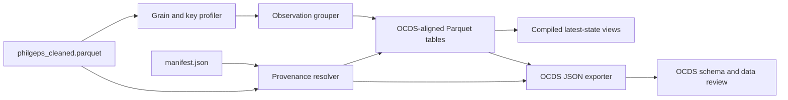

# Architecture

## Data flow



## Output layout

```text
OCDS_ETL/
├── config/
│   ├── field_mapping.json
│   ├── codelist_mapping.json
│   └── publication.json
├── docs/
├── scripts/
├── artifacts/
│   ├── grain_profile.json
│   ├── mapping_coverage.json
│   └── validation_report.json
└── outputs/
    ├── parquet/
    │   ├── contracting_processes.parquet
    │   ├── releases.parquet
    │   ├── tenders.parquet
    │   ├── tender_items.parquet
    │   ├── awards.parquet
    │   ├── award_items.parquet
    │   ├── contracts.parquet
    │   ├── parties.parquet
    │   ├── party_roles.parquet
    │   ├── award_suppliers.parquet
    │   └── record_sources.parquet
    └── ocds/
        ├── release-packages/
        └── record-packages/
```

The Parquet outputs also include `data_quality_issues.parquet`, which records
incomplete and ambiguous entities or relationships without removing their
source observations.

The directories under `config/`, `artifacts/`, and `outputs/parquet/` are
created during implementation. Table filenames are stable and are not split by
source file. Partitioning can be added only if measured query or distribution
needs justify it.

## Transformation stages

### 1. Profile grain and identifiers

Measure reuse, missingness, and conflicts for bid references, solicitation
numbers, line-item numbers, award references, contract numbers, organizations,
and source periods. This stage produces evidence; it does not assign final IDs.

### 2. Build process-state candidates

Rows sharing a candidate process key are grouped. Repeated scalar fields are
compared, child arrays are deduplicated by candidate child keys, and conflicts
are recorded. Arrays are sorted deterministically.

### 3. Hash canonical states

A canonical representation of the complete mapped state is hashed. Identical
states observed in different exports share one release and have multiple source
links. Different states for the same process become distinct releases.

### 4. Write relational Parquets atomically

All tables are first written to a temporary output directory. Primary-key,
conditional foreign-key, unresolved-relationship, row-count, and provenance
validation runs before the directory is renamed into place. Missing or
ambiguous relationships are retained as data-quality findings; they do not
abort the analytical build.

The implementation first writes an internal `release_index.parquet` under
`outputs/.build/`. It maps every collision-free source observation key to its
deterministic process and release IDs. Final tables are independently
restartable and join through this index; it is build state, not a published
OCDS-aligned table.

### 5. Compile preferred process records

Releases are ordered using their evidence-backed release date and observation
period. The latest accepted values create compiled analytical views. Original
releases remain immutable.

### 6. Export OCDS packages

Tables are assembled into release or record packages, timestamps receive an
explicit offset, empty properties are omitted according to OCDS rules, and JSON
is validated against the pinned schemas.

## Technology

- DuckDB performs grouped transformations and Parquet writes.
- Python orchestrates deterministic hashing, configuration, validation, and
  JSON package generation.
- Zstandard remains the default Parquet compression.
- Sorting and hashes must be independent of thread count and input row order.
