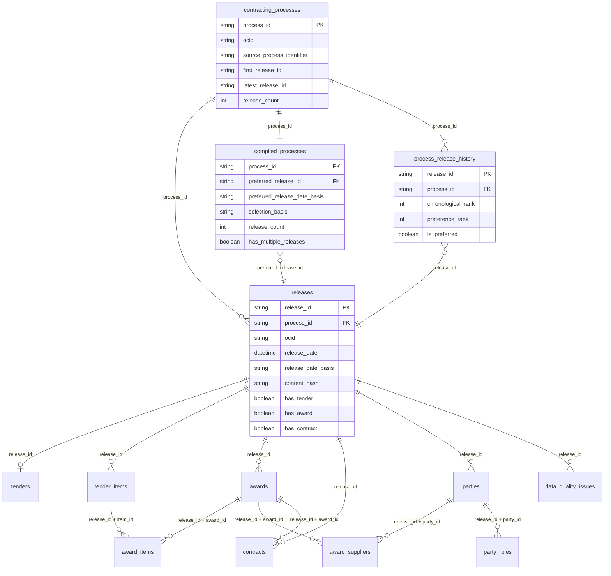
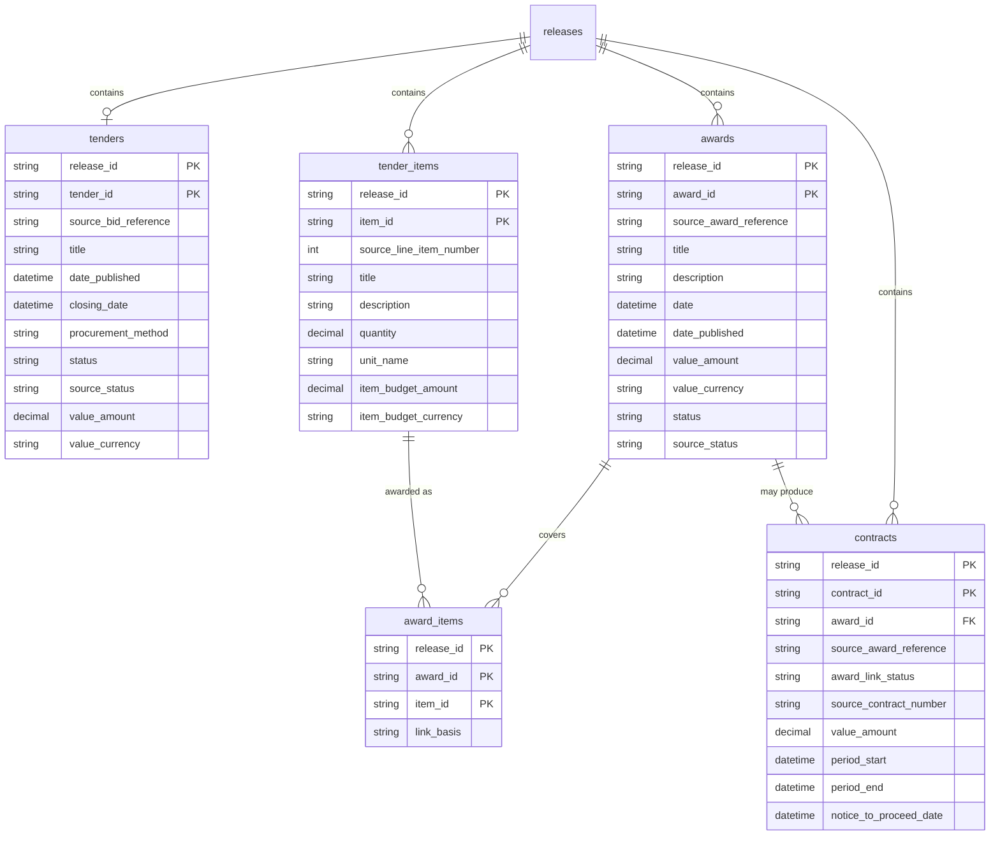
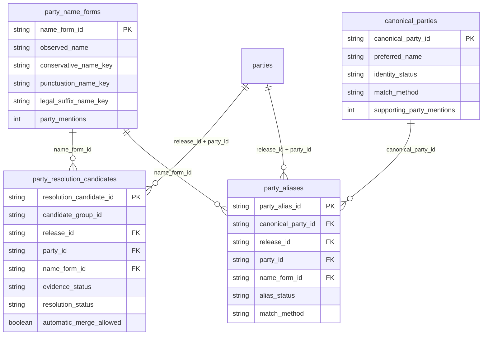
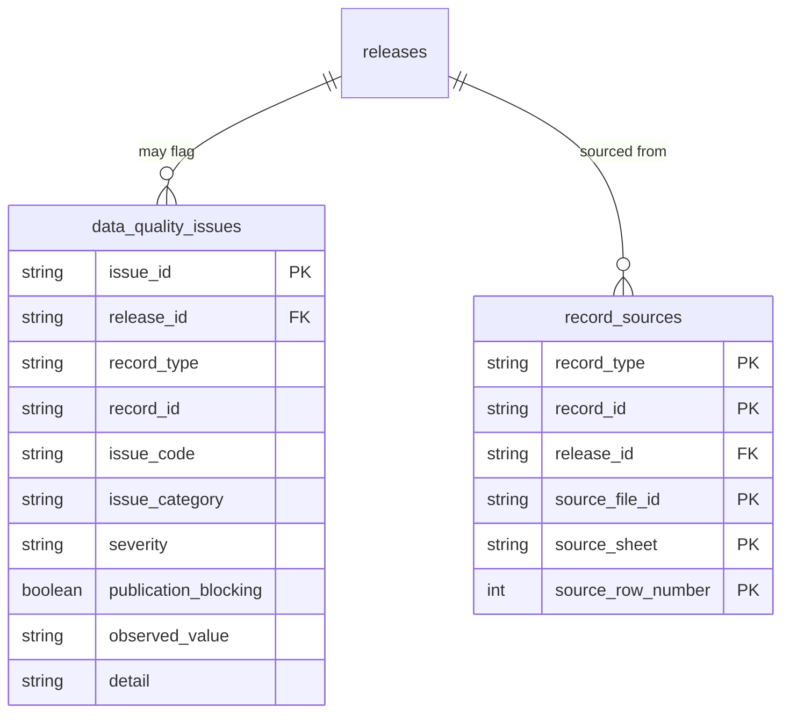
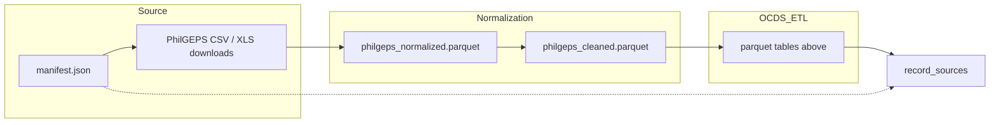

# OCDS Parquet data model (ERD)

Entity-relationship overview of the PhilGEPS → OCDS parquet outputs consumed by
the Parquet Viewer. Grain and keys match `config/datasets.json` and the live
parquet schemas under `OCDS_ETL/outputs/parquet/`.

**Conventions**

- Solid relationships are join keys used by the viewer/ETL.
- `* _link_status` fields (`matched` / `missing` / `ambiguous`) mean the FK may
  be unresolved — do not treat those rows as hard foreign keys in UI links.
- Child OCDS objects are scoped by `(release_id, …)`. Across multi-release
  processes, the same object id can appear in more than one release state.
- Identifier prefixes (examples): `pgcp_` process, `pgrl_` release, `pgaw_`
  award, `pgct_` contract, `pgti_` tender item, `pgca_` provisional canonical
  party.

---

## 1. Core contracting process (overview)



---

## 2. Tender, awards, items, contracts



**Partial award note:** tender line items with no `award_items` row are
unawarded for that release (shown under Bids close on the timeline).

---

## 3. Parties, roles, and supplier assertions

```mermaid
erDiagram
  releases ||--o{ parties : mentions
  parties ||--o{ party_roles : "has role"
  awards ||--o{ award_suppliers : "supplier assertion"
  parties ||--o{ award_suppliers : "asserted as"
  contracts ||--o{ award_suppliers : "optional via award"

  parties {
    string release_id PK
    string party_id PK
    string name
    string name_key
    string source_organization_type
    string identity_confidence
  }

  party_roles {
    string release_id PK
    string party_id PK
    string role PK
  }

  award_suppliers {
    string award_supplier_assertion_id PK
    string release_id FK
    string award_id FK
    string party_id FK
    string source_award_reference
    string source_supplier_label
    string source_joint_venture
    string award_link_status
    string party_link_status
  }
```



Typical roles: `procuringEntity`, `supplier`. Being listed in `party_roles`
does **not** imply an award — only `award_suppliers` assertions do.

Authoritative supplier → contract path (when links are `matched`):

```text
party_name_forms
  → parties + party_roles (supplier)
  → award_suppliers
  → awards
  → contracts
  → releases → contracting_processes
  → record_sources
```

---

## 4. Party normalization and provisional identity

These tables are analytical / provisional. Canonical IDs use the `pgca_`
prefix and are **not** official organization identifiers.



---

## 5. Provenance and data quality



`record_sources` links any derived record (`record_type` + `record_id`) back to
a physical PhilGEPS source row via `source_file_id` (see
`RAW_DATA_DOWNLOADER/dataset/manifest.json`).

---

## 6. Upstream source layers (outside OCDS parquet)

Not OCDS entities, but part of the end-to-end data lineage:



---

## 7. Dataset index (primary keys)

| Dataset | Primary key | Record type |
|---|---|---|
| `contracting_processes` | `process_id` | — |
| `compiled_processes` | `process_id` | — |
| `releases` | `release_id` | `release` |
| `process_release_history` | `release_id` | `release` |
| `tenders` | `release_id`, `tender_id` | `tender` |
| `tender_items` | `release_id`, `item_id` | `tender_item` |
| `awards` | `release_id`, `award_id` | `award` |
| `award_items` | `release_id`, `award_id`, `item_id` | `award_item` |
| `contracts` | `release_id`, `contract_id` | `contract` |
| `parties` | `release_id`, `party_id` | `party` |
| `party_roles` | `release_id`, `party_id`, `role` | — |
| `award_suppliers` | `award_supplier_assertion_id` | `award_supplier_assertion` |
| `party_name_forms` | `name_form_id` | — |
| `party_resolution_candidates` | `resolution_candidate_id` | — |
| `canonical_parties` | `canonical_party_id` | — |
| `party_aliases` | `party_alias_id` | — |
| `data_quality_issues` | `issue_id` | `data_quality_issue` |
| `record_sources` | `record_type`, `record_id`, `source_file_id`, `source_sheet`, `source_row_number` | — |

See also [03_data_catalog.md](./03_data_catalog.md) for row counts and viewer
roles, and [09_supplier_contract_queries.md](./09_supplier_contract_queries.md)
for supplier identity scopes.
